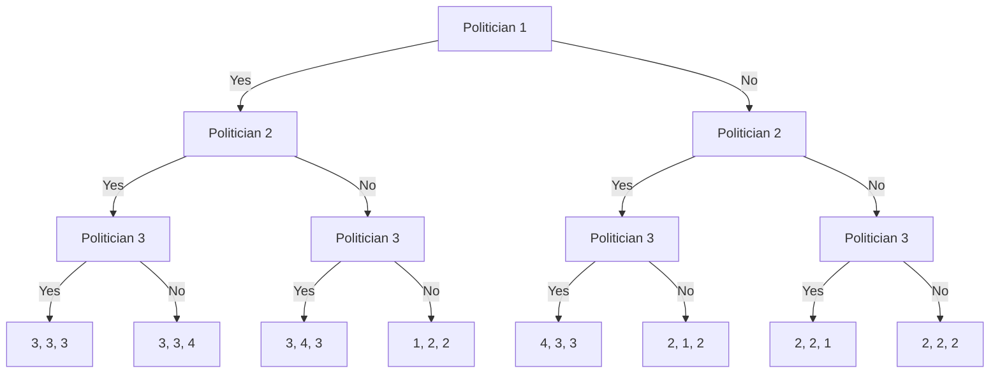
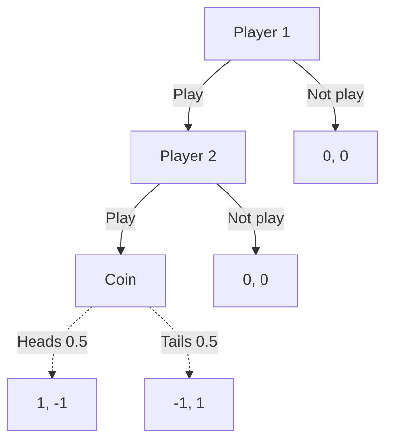
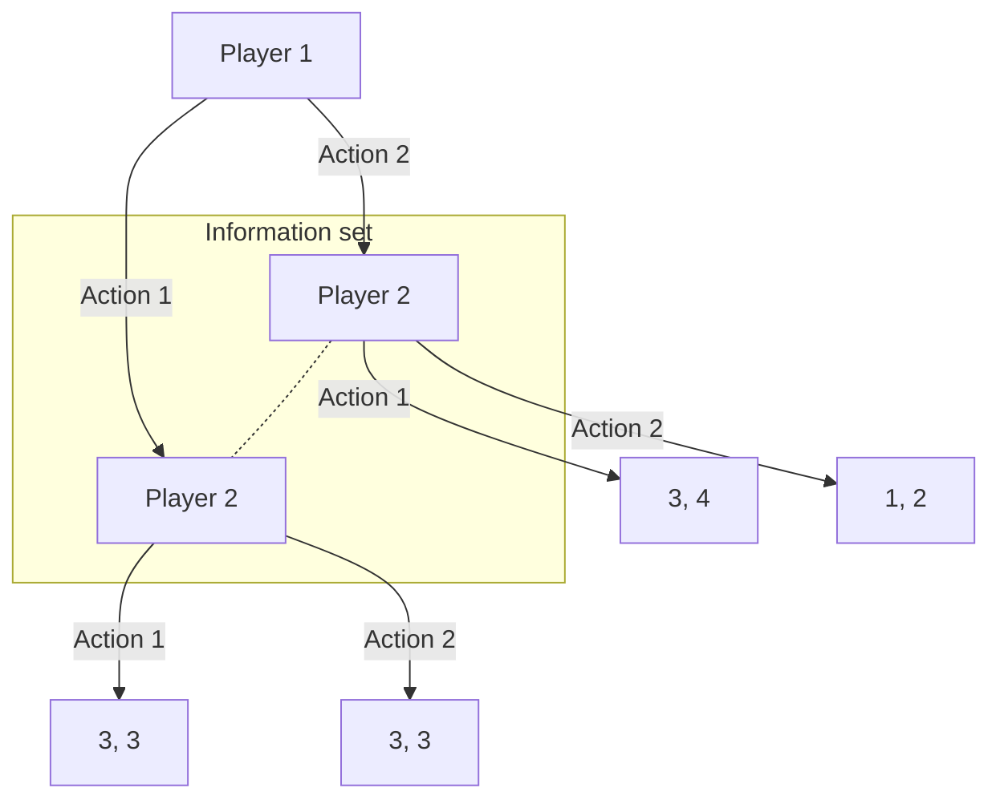

## Introduction to Games

Game theory studies situations where the outcome for one person depends not only on their own choices but on the choices of others.

A game is a process consisting of:

- a set of **players** (at least two)
- an **initial situation**
- **rules** the players must follow
- all possible **final situations** (outcomes)
- the **preferences** of all players over the final situations

### Players

**Players** are the agents that can make decisions in the game. They are assumed to be:

- **Selfish**: each player only cares about their own preferences over the outcomes.
- **Rational**: never takes action $a$ if another action $b$ is at least as good in every situation and strictly better in some.

The rationality is based on 5 assumptions:

1. Players can rank the outcomes of the game.
2. Players can provide a utility function for their ranking.
3. Players use the laws of probability consistently.
4. Players understand the consequences of their and others' actions, and the consequences of that information for every other player.
5. Players use decision theory whenever possible

#### Preference

A **preference relation** $\succeq$ ("is at least as good as") on a set $X$ is a binary relation such that for all $x, y, z \in X$:

- **Reflexive**: $x \succeq x$
- **Complete**: $x \succeq y$ or $y \succeq x$ (or both)
- **Transitive**: if $x \succeq y$ and $y \succeq z$, then $x \succeq z$

#### Utility functions

A **utility function** representing $\succeq$ is a function $u : X \to \mathbb{R}$ such that

$$u(x) \geq u(y) \iff x \succeq y$$

## Extensive Form Representation

### Perfect information

An **extensive form with perfect information** is a game represented as a **decision tree** where each player takes decisions in sequence and knows all the events that previously occurred.

The structure of an extensive form game with perfect information is:

1. a finite set of players $N = \{1, \dots, n\}$
2. a game tree $(V, E, x_0)$
3. a partition $\{P_1, \dots, P_n, P_{n+1}\}$ of the non-leaf vertices (decision nodes) into $n + 1$ sets
   - $P_i$, for $i \leq n$: nodes where player $i$ chooses a child (a move).
   - $P_{n+1}$: nodes with a **chance move** (it can be empty).
4. a probability distribution, for each vertex in $P_{n+1}$
5. an $n$-dimensional vector attached to each leaf (the list of outcomes)

> e.g. Three politicians vote **sequentially and publicly** on a salary raise. They would like the raise, but also want to vote against it to not lose public support. Optimal for each: _get the raise while voting against it_.
>
> Utilities depend on the individual vote and the final outcome:
>
> | Value | Meaning          |
> | ----- | ---------------- |
> | 1     | YES and no raise |
> | 2     | NO and no raise  |
> | 3     | YES and raise    |
> | 4     | NO and raise     |

#### Extensive form with chance

In case of chance nodes the $P_{n+1}$ partition is non-empty.

> Two players decide in sequence whether to play. If both play, a coin is tossed (random component R): heads, player 1 wins; tails, player 2 wins.

### Backward induction

The **backward induction** method allows to find the rational outcome of a perfect-information game using a dynamic programming approach.
Starting from the leaves, at each decision node, the player there picks the action that maximizes their own payoff, and that choice is treated as the resolved outcome for that node. This process continues up the tree until reaching the root.

> Applying backward induction to the voting game:
>
> | Node | Player | Choice | Resolves to |
> | ------------ | ------ | ------------------------------ | ------------- |
> | after (Y, Y) | 3 | No: (3,3,**4**) > (3,3,**3**) | (3, 3, 4) |
>| after (Y, N) | 3 | Yes: (3,4,**3**) > (1,2,**2**) | (3, 4, 3) |
>| after (N, Y) | 3 | Yes: (4,3,**3**) > (2,1,**2**) | (4, 3, 3) |
>| after (N, N) | 3 | No: (2,2,**2**) > (2,2,**1**) | (2, 2, 2) |
>| after Y | 2 | No: (3,**4**,3) > (3,**3**,4) | (3, 4, 3) |
>| after N | 2 | Yes: (4,**3**,3) > (2,**2**,2) | (4, 3, 3) |
>| root | 1 | No: (**4**,3,3) > (**3**,4,3) | **(4, 3, 3)** |
>
>Leading to the rational outcome of the game: politician 1 votes _No_, politician 2 votes _Yes_, and politician 3 votes _Yes_. The raise happens, and only politician 1 gets to dodge the blame while getting the ideal payoff.

### Perfect Information Theorems (Von Neumann theorem)

For any finite two-player game of perfect information with no chance moves (chess is the classic example), exactly one of the following holds:

1. Player 1 has a **winning strategy**, regardless of what player 2 does.
2. Player 2 has a **winning strategy**, regardless of what player 1 does.
3. Both players have a strategy that **guarantees at least a draw**, regardless of what the other does.

A winning strategy for player 1 means:

$$\exists a_1 \in A_1 : \forall b_1 \in B_1 : \exists a_2 \in A_2 : \forall b_2 \in B_2 : \cdots : \exists a_n \in A_n : \forall b_n \in B_n : \text{P1 wins}$$

This notation means that there exists a sequence of moves for player 1 such that, no matter what moves player 2 makes, player 1 can always respond in a way that leads to a win.

If this is not true, then player 2 can guarantee at least a draw.

The same holds for the other player.

### Solution concepts

The rational outcome of a game is called a **solution** and can be classified as follows:

- **Very weak solution**: A rational outcome exists, but it is not practically reachable/computable
- **Weak solution**: The outcome is known, but not _how_ to reach it
- **Solution**: The outcome is known and a way to reach it is known

## Impartial Combinatorial Games

An **impartial combinatorial game** is a game with the following properties:

- two players move in alternate order
- a finite number of positions
- the players follow the same rules
- no chance

In these games all the positions can be classified as:

- **P-position**: losing position for the player to move, each move goes to an N-position.
- **N-position**: winning position for the player to move, there is at least one move to a P-position.

### Nim

**Nim** is an impartial combinatorial game with $k$ piles $(n_1, \dots, n_k)$, on each turn a player removes any positive number of objects from a single pile, and the player who takes the last object wins.

Nim is solved with the **nim-sum**, $\oplus$: binary addition without carrying (equivalently, bitwise XOR). The natural numbers under $\oplus$ form an abelian group with identity $0$.

> Example: $1 \oplus 2 \oplus 4 \oplus 1 \to 001 \oplus 010 \oplus 100 \oplus 001 = 110 = 6$.

According to the **Bouton theorem**, a position $(n_1, \dots, n_k)$ is a P-position if and only if the nim-sum of the pile sizes is zero:

$$n_1 \oplus n_2 \oplus \cdots \oplus n_k = 0$$

## Imperfect Information

Games with **imperfect information** are those where players do not have complete knowledge of the game state when making decisions. This can occur due to simultaneous moves, hidden information, or uncertainty about the actions of other players.

Player $i$ knows they are in the **information set** $U_i$ but not in which vertex. Each element of the partition is an available move.

An **information set** for player $i$ is a pair $(U_i, A(U_i))$ with:

- $U_i \subseteq P_i$ a nonempty set of vertices $v_1, \dots, v_k$;
- every vertex $v_j \in U_i$ has the same number of children (same available moves);
- $A(U_i)$ is a partition of the children of $v_1 \cup \dots \cup v_k$ such that each element of the partition contains exactly one child of each $v_j$.

The formal definition is:

1. a finite set of players $N = \{1, \dots, n\}$
2. a game tree $(V, E, x_0)$
3. a partition $\{P_1, \dots, P_n, P_{n+1}\}$ of the non-leaf vertices
4. for each player $i$, a partition the decisions nodes $P_i$ into $k_i$ information sets $(U_i^j, A(U_i^j)), j = 1, \dots, k_i$
5. a probability distribution, for each vertex in $P_{n+1}$
6. an $n$-dimensional vector attached to each leaf (the list of outcomes)

A game with perfect information can be represented as a game with imperfect information where each information set contains is a singleton.

## Strategies

A **Strategy** is a complete plan of action for a player, specifying what they will do at every information set they might encounter.

There are two types of strategies:

- **Pure strategy**: at each information set, the player chooses a specific action deterministically.
- **Mixed strategy**: at each information set, the player chooses an action according to a probability distribution over the available actions.

### Strategic Form Representation

The **strategic form** representation of a game lists all possible combinations of strategies for each player, along with the resulting payoffs using a **payoff matrix**.

For two players, the payoff matrix is a bimatrix where each cell contains a pair of payoffs corresponding to the strategies chosen by the players.

$$\begin{pmatrix} (8,8) & (2,7) \\ (7,2) & (0,0) \end{pmatrix} \qquad \text{Utilities of Player 1: } \begin{pmatrix} 8 & 2 \\ 7 & 0 \end{pmatrix}$$

### Dominant Strategy

A strategy **dominates** another if it gives a better outcome regardless of what the other player does, based on the rationality assumption.

In the bimatrix above, the second row is strictly dominated by the first, so Player 1 plays row 1; likewise the first column strictly dominates the second for Player 2. Outcome: $(8,8)$.

## Zero-Sum Games

In a **zero-sum game** whatever one player gains, the other loses and it's represented by a triplet $(X, Y, f : X \times Y \to \mathbb{R})$:

- $X$ is the strategy space of Player 1 (Pl1). In the finite case $X = \{1, \dots, n\}$
- $Y$ is the strategy space of Player 2 (Pl2). In the finite case $Y = \{1, \dots, m\}$
- $f(x, y)$ is what Pl1 gets from Pl2 when they play $x, y$. The utility of Pl2 is $g(y, x) = -f(x, y)$.

The game is represented by the  **payoff matrix** $P$ that being the utilities opposite, is enough to describe the game without the bi-matrix:

$$P = \begin{pmatrix} p_{11} & \cdots & p_{1m} \\ \vdots & \ddots & \vdots \\ p_{n1} & \cdots & p_{nm} \end{pmatrix}$$

### Conservative values

The **conservative value** of a player is the best guaranteed outcome they can secure, assuming the opponent plays optimally against them.

- Pl1 looks at each row, assumes Pl2 will choose the column that minimizes its lost, and keeps the row that gives the best outcome in the worst-case scenario.
  - Finite case: $v_1 = \max_i \min_j p_{ij}$ given by playing row $\bar{i}$ ($p_{\bar{i} j} \geq v_1 \forall j$)
  - General case: $v_1 = \sup_x \inf_y f(x, y)$ given by playing $x = \bar{x}$
- Pl2 looks at each column, assumes Pl1 will choose the row that maximizes its gain, and keeps the column that gives the best outcome in the worst-case scenario.
  - Finite case: $v_2 = \min_j \max_i p_{ij}$ given by playing column $\bar{j}$ ($p_{i \bar{j}} \geq v_2 \forall i$)
  - General case: $v_2 = \inf_y \sup_x f(x, y)$ given by playing $y = \bar{y}$

For any nonempty $X, Y$ and any $f : X \times Y \to \mathbb{R}$:

$$v_1 = \sup_x \inf_y f(x, y) \leq \inf_y \sup_x f(x, y) = v_2$$

> Proof: For all $x, y$:
>
> $$\alpha(x) = \inf_{y'} f(x, y') \leq f(x, y) \leq \sup_{x'} f(x', y) = \beta(y)$$
>
> Since $\alpha(x) \leq \beta(y) \forall x \in X, y \in Y$, $\sup_x \alpha(x) \leq \inf_y \beta(y)$.

#### Pure optimal strategies

If $v_1 = v_2 = v$, the game has value $v$ and can be solved in pure strategies by:

- Pl1: play row $\bar{i}$ with $p_{\bar{i} j} \geq v \forall j$
- Pl2: play column $\bar{j}$ with $p_{i \bar{j}} \leq v \forall i$

#### Mixed Strategy

If $v_1 < v_2$, the game has no solution in pure strategies, but it can be solved in **mixed strategies**, represented by $(\Sigma_n, \Sigma_m, f(x, y) = (x, Py))$.

$\Sigma_k$ is the probability distribution ($k = n$ for Pl1, $k = m$ for Pl2) over the pure strategies:

$$\Sigma_k = \{ x = (x_1, \dots, x_k) : x_i \geq 0, \ \sum_{i=1}^k x_i = 1 \}$$

Expected utility is the weighted sum of the payoffs with the product probabilities:

$$f(x, y) = \sum_{i=1}^n \sum_{j=1}^m x_i y_j  p_{ij} = (x, Py)$$

### Convexity

A set $C \subseteq \mathbb{R}^n$ is **convex** if the segment joining any two points of $C$ stays in $C$:

$$\lambda x + (1 - \lambda) y \in C \quad \forall x, y \in C, \forall \lambda \in [0, 1]$$

A **convex combination** of $x_1, \dots, x_n$ is a vector $x = \lambda_1 x_1 + \cdots + \lambda_n x_n$ with $\lambda_i \geq 0$ and $\sum_i \lambda_i = 1$

The **convex hull** of $C$ is the smallest convex set containing $C$:

$$\mathrm{co} C = \bigcap_{A \in \mathcal{C}} A, \quad \mathcal{C} = \{ A : C \subseteq A, A \text{ convex} \}$$

Equivalently, it is the set of all convex combinations of points of $C$:

$$\mathrm{co} C = \{ \sum_{i=1}^n \lambda_i c_i : \lambda_i \geq 0, \ \sum_{i=1}^n \lambda_i = 1, \ c_i \in C, \ n \in \mathbb{N} \}$$

If $C$ is a finite set of points, $\mathrm{co} C$ is a **polytope**.

The **complement** of $C$ is the set of all points in $\mathbb{R}^n$ that are not in $C$: $C^c = \mathbb{R}^n \setminus C$.

The **interior** of $C$ is the set of points that have a neighborhood entirely contained in $C$: $\mathrm{int} C = \{ x \in C : \exists r > 0, B_r(x) \subseteq C \}$.

The **closure** of $C$ is the union of $C$ and its boundary: $\mathrm{cl} C = C \cup \partial C$. It is the set of limits of sequences of points of $C$.

#### Projection

Given a closed convex set $C$ and a point $x \notin C$, the **projection** $p$ of $x$ onto $C$ is the closest point of $C$ to $x$ ($|p - x| \leq |c - x| \forall c \in C$).

$$\langle x - p, c - p \rangle \leq 0 \quad \forall c \in C$$

- As $C$ is convex, the projection $p$ is unique.
- The angle at $p$ between $x$ and any $c \in C$ is obtuse.

#### Separation

Given a closed convex set $C$ and a point $\bar{x} \notin C$, it's possible to find a hyperplane characterized by a normal vector $x^* \neq 0$ that separates $\bar{x}$ from $C$.

$$\langle x^*, c \rangle \geq \langle x^*, \bar{x} \rangle \quad \forall c \in C$$

> Taking the closest point $p$ ($\langle \bar{x} - p, c - p \rangle \leq 0$) of $C$ to $\bar{x}$, the hyperplane is given by the normal vector $x^* = p - \bar{x}$ that is orthogonal to the segment joining $\bar{x}$ and $p$.
>
> By substitution: $\langle \bar{x} - p, c - p \rangle = \langle -x^*, c - \bar{x} - x^* \rangle = -\langle x^*, c - \bar{x} \rangle + \|x^*\|^2 \leq 0$, so $\langle x^*, c - \bar{x} \rangle \geq \|x^*\|^2 > 0$ that by linearity:
>
> $$\langle x^*, c \rangle \geq \langle x^*, \bar{x} \rangle \quad \forall c \in C$$
>
> meaning that all the point of $C$ are on one side of the hyperplane with normal vector $x^*$.

For a closed convex $C$ and a point $x$ on its boundary there is a **supporting hyperplane** at $x$.

Given two closed convex sets $A, C$ with $\mathrm{int} A \cap C = \emptyset$, there is a **separating hyperplane** $H = \{ x : (x^*, x) = b \}$ that separates $A$ and $C$ into the two different half-spaces it generates.

$$\langle x^*, a \rangle \geq b \geq \langle x^*, c \rangle \quad \forall a \in A, \forall c \in C$$

> Taking the set $\mathrm{int} A - C = \{ x = a - c : a \in \mathrm{int} A, c \in C \}$, as they are disjoint the point $0$ is not in it, and it is convex as the difference of two convex sets.
>
> By the separation theorem there is a hyperplane with normal vector $x^* \neq 0$ that separates it from $0$:
>
> $$\langle x^*, a - c \rangle \geq 0 \quad \forall a \in \mathrm{int} A, c \in C$$
>
> by linearity $\langle x^*, a \rangle - \langle x^*, c \rangle \geq 0$, so $\langle x^*, a \rangle \geq \langle x^*, c \rangle$.

### Von Neumann theorem

A **two-player zero-sum game** has always a **rational outcome** in mixed strategies, meaning that there are $\bar{x} \in \Sigma_n$, $\bar{y} \in \Sigma_m$ and a value $v$ such that $v_1 = v_2 = v$.

If a player knows the (mixed) strategy of the other, it can always answer with a pure strategy.

Once Pl1 knows the strategy $\bar{y}$ of Pl2, it need to maximize the utility function $f(x, \bar{y}) = \langle x, P \bar{y} \rangle$ over $x \in \Sigma_n$. The maximum is attained at a vertex of $\Sigma_n$, that is a pure strategy.

There is a distribution $\bar{x}$ over rows such that against every column Pl1 gets at least $v$, and a distribution $\bar{y}$ over columns such that against every row Pl2 pays at most $v$.

> The columns of $P$ are points of $\mathbb{R}^n$ and a mixed strategy of Pl2 is a convex combination of those points $C = \mathrm{co}\{p_{\cdot 1}, \dots, p_{\cdot m}\}$.
>
> Taking the set $Q_t = {x \in \mathbb{R}^n : x_i \leq t, \forall i}$ where $t$ is the value of the game.
>
> The value $v$ is the highest $t$ for which $Q_t$ and $C$ do not meet ($v = \sup \{ t \geq 0 : Q_t \cap C = \emptyset \}$). meaning $v$ is the lowest ceiling Pl2 can enforce on all rows.
>
> For the separation theorem, there is a hyperplane with normal vector $\bar{x}$ that separates $Q_v$ and $C$ such that:
>
> $$\langle \bar{x}, u \rangle \leq b \leq \langle \bar{x}, w \rangle \quad \forall u \in Q_v, \forall w \in C$$
>
> - $\bar{x}$ is a probability distribution (all $\bar{x}_i \geq 0$ and $\sum_i \bar{x}_i = 1$)
> - $b = v$ (the hyperplane is tangent to $Q_v$)

### Optimal strategies by Linear Programming

The optimal strategy of a game can be found by solving a linear programming problem.

Pl1 chooses $x \in \Sigma_n$ to **maximize** $v$ subject to $\langle x, p_{\cdot j} \rangle \geq v$ for every column $j$:

$$\begin{aligned} \max_{x, v} \quad & v \\ \text{s.t.} \quad & \sum_{i=1}^n x_i p_{ij} \geq v, \quad j = 1, \dots, m \\ & \sum_{i=1}^n x_i = 1, \quad x_i \geq 0 \end{aligned} \qquad \begin{cases} \max_{x, v} v \\ P^T x \geq v 1_m \\ x \geq 0 \\ \langle 1, x \rangle = 1 \end{cases}$$

Pl2 chooses $y \in \Sigma_m$ to **minimize** $w$ subject to $\langle p_{i \cdot}, y \rangle \leq w$ for every row $i$:

$$\begin{aligned} \min_{y, w} \quad & w \\ \text{s.t.} \quad & \sum_{j=1}^m y_j p_{ij} \leq w, \quad i = 1, \dots, n \\ & \sum_{j=1}^m y_j = 1, \ y_j \geq 0 \end{aligned} \qquad \begin{cases} \max_{y, w} w \\ Py \leq w 1_n \\ y \geq 0 \\ \langle 1, y \rangle = 1 \end{cases}$$

The two problems are dual to each other.

For the weak duality, let $v, w$ be the optimal values of the primal and dual problems. Then $v \leq w$.

For the strong duality, if the primal and dual are both feasible, then $v = w$.

For the complementary condition, let $\bar{x}, \bar{y}$ be primal and dual feasible. They are simultaneously optimal iff:

$$\begin{cases} \forall i: \ \bar{x}_i > 0 \Rightarrow \sum_{k=1}^m p_{ik} \bar{y}_k = v \\ \forall j: \ \bar{y}_j > 0 \Rightarrow \sum_{k=1}^n p_{kj} \bar{x}_k = v \end{cases}$$

#### Indifference principle

The indifference principle states that in a mixed strategy equilibrium, each player is indifferent among the pure strategies that are played by the other player.

### Fair games

A finite zero-sum game is **fair** if no player has an advantage over the other. In a fair game, the value is $0$, meaning that if both players play optimally, neither player can expect to gain or lose anything on average.

If the $P$ matrix is **antisymmetric** if $p_{ij} = -p_{ji} \forall i, j$ , it's possible to exchange the roles of the players ($P^T = -P$).

> Since $P^T = -P$,by playing the same strategy each player can get 0:
>
> $$\langle Px, x \rangle = \langle x, P^T x \rangle = -\langle x, Px \rangle = -\langle Px, x \rangle \Rightarrow f(x, x) = 0 \forall x$$
>
> - $v_1 \leq 0$;
> - $v_2 \geq 0$.
>
> For von Neumann $v_1 = v_2 = v = 0$, as 0 is the only common value.
>
> If $\bar{x}$ is optimal for Pl1, then $(\bar{x}, P y) \geq 0 \ \forall y$, which by antisymmetry is $(P \bar{x}, y) \leq 0 \ \forall y$.

## Nash Equilibrium

A **two-player non-cooperative game** is a quadruple $(X, Y, f : X \times Y \to \mathbb{R}, g : X \times Y \to \mathbb{R})$:

- $X$, $Y$: strategy sets of Player 1 and Player 2
- $f$ $g$: utility function of Player 1 and Player 2

A **Nash equilibrium profile (NEp)** is a pair $(\bar{x}, \bar{y}) \in X \times Y$ such that

- $f(\bar{x}, \bar{y}) \geq f(x, \bar{y}) \quad \forall x \in X$
- $g(\bar{x}, \bar{y}) \geq g(\bar{x}, y) \quad \forall y \in Y$

It is _stable with respect to unilateral deviations_, meaning that neither player can improve their utility by changing strategy alone.

In case of games with $n$ players, player $i$ has strategy set $X_i$ and payoff $u_i : X = \prod_{i=1}^n X_i \to \mathbb{R}$.

- A strategy profile is indicated by $x = (x_1, \dots, x_n)$
- $x_{-i}$ denotes the vector $x$ without the $i$-th component.

Then $\bar{x} = (\bar{x}_i)_{i=1}^n$ is a NEp if:

$$u_i(\bar{x}) \geq u_i(x_i, \bar{x}_{-i}), \quad \forall i, x_i \in X_i$$

**Dominant strategies:**

Suppose $\bar{x}$ is a **(weakly) dominant** strategy for Player 1:

$$f(\bar{x}, y) \geq f(x, y) \quad \forall x, y$$

If $\bar{y}$ maximizes the function $g(\bar{x}, y)$ for Player 2, then $(\bar{x}, \bar{y})$ is a NEp.

- If $\bar{x}$ is **weakly** dominant, other equilibria can exist.
- If $\bar{x}$ is **strictly** dominant ($f(\bar{x}, y) > f(x, y) \ \forall x \neq \bar{x}, y$), there are no other equilibria.

**Backward induction:**

Backward induction solution is a NEp in every perfect-information game, since players make an optimal choice in every part of the tree. But there can be different equilibria than those given by backward induction.

**Zero-sum games:**

Given a zero-sum game with payoff functions $f$ ($g = -f$), the following are equivalent:

1. $(\bar{x}, \bar{y})$ satisfies $f(x, \bar{y}) \leq f(\bar{x}, \bar{y}) \leq f(\bar{x}, y) \ \forall x \in X$, $y \in Y$ (a NEp)
2. these are satisfied:
    - (i) $\inf_y \sup_x f(x, y) = \sup_x \inf_y f(x, y)$;
    - (ii) $\inf_y f(\bar{x}, y) = \sup_x \inf_y f(x, y)$;
    - (iii) $\sup_x f(x, \bar{y}) = \inf_y \sup_x f(x, y)$

meaning that the NEp is the optimal solution of the game and $f(\bar{x}, \bar{y}) = v$.

> _Proof (1 implies 2)_:
>
> $$v_2 = \inf_y \sup_x f(x, y) \leq \sup_x f(x, \bar{y}) = f(\bar{x}, \bar{y}) = \inf_y f(\bar{x}, y) \leq \sup_x \inf_y f(x, y) = v_1$$
>
> Since $v_1 \leq v_2$ always holds, all inequalities are equalities.
>
>_Proof (2 implies 1)_:
>
>$$\inf_y \sup_x f = \sup_x f(x, \bar{y}) \geq f(\bar{x}, \bar{y}) \geq \inf_y f(\bar{x}, y) = \sup_x \inf_y f$$
>
>Because of (i) all inequalities are equalities.

### Existence of Nash equilibria

> A multifunction $F : A \to 2^B$ that assigns to each point of $A$ a subset of $B$ ($2^B$ is the powerset, the set of all subsets of $B$)

The **Best response** is multifunction that maps each strategy of a player to the set of strategies that maximize their utility:

$$BR_1 : Y \to 2^X, \ BR_1(y) = \argmax f(\cdot, y)$$
$$BR_2 : X \to 2^Y, \ BR_2(x) = \argmax g(x, \cdot)$$

The **best response multifunction** ($BR : X \times Y \to 2^X \times 2^Y$, $BR(x, y) = (BR_1(y), BR_2(x))$) is the set of all strategy profiles that are best responses to each other. EveryNEp is inside $BR$.

#### Kakutani's theorem

Given a compact convex subset of a Euclidean space $Z$ and $F : Z \to 2^Z$ with $F(z)$ nonempty, closed and convex for every $z$, and with closed graph.

Then $F$ has a fixed point $\bar{z} \in Z$ with $\bar{z} \in F(\bar{z})$.

> A closed graph means that if taking a sequence $z_n \to z$ and a sequence of points $u_n \in F(z_n)$ that converges to $u$, then $u \in F(z)$.

#### Nash's theorem

Given a game $(X, Y, f, g)$, suppose:

- $X, Y$ are compact convex subsets of some Euclidean space;
- $f, g$ are continuous;
- $x \to f(x, y)$ is quasi-concave for every $y$;
- $y \to g(x, y)$ is quasi-concave for every $x$.

Then the game has an equilibrium.

> The best response multifunctions $BR_1$ and $BR_2$ are nonempty, closed and convex-valued. Those properties are preserved by the product $BR = BR_1 \times BR_2$.
>
> $BR$ is a closed graph: if taking a sequence $(x_n, y_n)$ that converges to $(x, y)$ and a sequence of best responses to those strategies ($(u_n, v_n) \to (u, v)$) $(u, v) \in BR(x, y)$:
>
> $$f(u_n, y_n) \geq f(z, y_n) \quad \forall z \in X, \qquad g(x_n, v_n) \geq g(x_n, t) \quad \forall t \in Y$$
>
> that the limit is:
>
> $$f(u, y) \geq f(z, y) \quad \forall z \in X, \qquad g(x, v) \geq g(x, t) \quad \forall t \in Y$$
>
> Now it's possible to use the Kakutani theorem to find a fixed point of $BR$, which is a NEp.

#### Finite games

A finite game $(A, B)$ always admits a Nash equilibrium profile in **mixed strategies**.

- The strategy sets $X$ and $Y$ are simplexes, which are compact and convex;
- $f(x, y) = \langle x, Ay \rangle$ and $g(x, y) = \langle x, By \rangle$ are continuous and quasi-concave in each variable.

Those are the conditions of Nash's theorem, so there is a NEp $(\bar{x}, \bar{y})$.

Given a finite game $(A, B)$, the set of NEp is found by computing the best response multifunctions $BR_1$ and $BR_2$ and finding their intersections in the $(x, y)$ plane.

The best response functions are found by mutiplying the payoff matrices by the mixed strategy of the opponent, and then maximizing the resulting linear function.

##### Support

Given a mixed NEp $(\bar{x}, \bar{y})$, the **support** ($\operatorname{spt}$) of a mixed strategy is the set of pure strategies that are played with positive probability.

The support of a mixed strategy have a expected payoff equal to the value of the game

$$\operatorname{spt} \bar{x} = \{ i : \sum_j a_{ij} \bar{y}_j = v \}, \qquad \operatorname{spt} \bar{y} = \{ j : \sum_i b_{ij} \bar{x}_i = w \}$$

The pure strategies outside the support have a strictly lower expected payoff than the value of the game:

$$\sum_j a_{ij} \bar{y}_j < v \quad \forall \ i \notin \operatorname{spt} \bar{x}, \qquad \sum_i b_{ij} \bar{x}_i < w \quad \forall \ j \notin \operatorname{spt} \bar{y}$$

In a **fully mixed** equilibrium, all pure strategies are in the support and give the same expected payoff equal to the value of the game.

#### Brute-force algorithm

The brute-force algorithm to find a mixed NEp is:

1. Guess the supports $\operatorname{spt}(\bar{x})$ and $\operatorname{spt}(\bar{y})$.
2. Ignoring the inequalities, solve the linear system of $n + m + 2$ equations in the unknowns $x, y, v, w$:

$$\begin{cases}\sum_{j=1}^m a_{ij} y_j = v \quad \forall i \in \operatorname{spt}(\bar{x}) \\ \sum_{i=1}^n b_{ij} x_i = w \quad \forall j \in \operatorname{spt}(\bar{y}) \\ \sum_{i=1}^n x_i = 1 \\ \sum_{j=1}^m y_j = 1 \\  x_i = 0 \ \forall i \notin \operatorname{spt}(\bar{x}) \\ y_j = 0 \ \forall j \notin \operatorname{spt}(\bar{y}) \end{cases}$$
3. Check if the ignored inequalities holds: $x_i \geq 0$, $y_j \geq 0$, $\sum_j a_{ij} y_j \leq v \ \forall i$ and $\sum_i b_{ij} x_i \leq w \ \forall j$. If they hold we have a mixed equilibrium. Otherwise guess other supports.

The number of support pairs is $(2^n - 1)(2^m - 1)$.

### Potential games

Finite game where all players have the same payoff $p : X \to \mathbb{R}$ ($u_i = p \ \forall i$).

Starting from any profile, if some player $i$ has a strategy $x_i'$ with $u_i(x_i', x_{-i}) > u_i(x_i, x_{-i})$, replace $x_i$ with $x_i'$ and repeat. Each iteration strictly increases $p(x)$, so no profile is visited twice.

Once no player can improve its payoff, we have reached a pure NE. This procedure is called **best-response dynamics** and terminates in at most $|X|$ steps.

If the payoff of the player $i$ differs from the common payoff by a term $c_i(x_{-i})$ that depends only on the others, the best-response dynamics is unchanged and still converges to the same pure NE.

$$\tilde{u}_i(x) = u_i(x) + c_i(x_{-i})$$

Meaning that the difference in payoffs doesn't change if the player changes strategy, while the others keep theirs fixed:

$$\Delta \tilde{u}_i(x_i', x_i, x_{-i}) = \Delta u_i(x_i', x_i, x_{-i}) = c(x_{-i})$$

A finite game with strategy sets $X_i$ and payoffs $u_i : X \to \mathbb{R}$ is a **potential game** if it is diff-equivalent to a game with common payoffs.

There is one **potential function** $p : X \to \mathbb{R}$ such that:

$$\Delta u_i(x_i', x_i, x_{-i}) = \Delta p(x_i', x_i, x_{-i}), \quad \forall i, x_i, x_i', x_{-i}$$

The potential function is determined, up to a constant, by fixing an arbitrary profile $\hat{x}$ and setting $p(\hat{x}) = 0$. Then $p$ is determined by changing one player at a time:

$$p(x_{-i}, x_i') = p(x) + \Delta u_i(x_i', x_i, x_{-i})$$

or equivalently by summing the differences along a path from $\hat{x}$ to $x$:

$$p(x) = \sum_{i=1}^n \Delta u_{i}(x_{-i}, x_{i}', x_{i})$$

### Congestion games

A **congestion game** is a potential game where the payoff of each player depends on the number of players using the same resources.

- Each player $i$ has a task that requires some resources from a set $R$. The strategy set $X_i$ contains the subsets $x_i \subseteq R$ that allow it to perform the task.
- Each resource $r \in R$ has a cost $c_r(n_r)$ depending on the number $n_r = \#\{j : r \in x_j\}$ of players using it, and player $i$ pays only for the resources it uses:

$$u_i(x) = \sum_{r \in x_i} c_r(n_r)$$

For the Rosenthal theorem, the potential function is the sum of the costs of all resources, counted once for each player using them:

$$p(x) = \sum_{r \in R} \sum_{k=1}^{n_r} c_r(k)$$

> Given a profile $x$ and a player $i$, the difference between the potential and the payoff of $i$ is:
>
> $$p(x) - u_i(x) = \sum_{r \in R} \sum_{k=1}^{n_r} c_r(k) - \sum_{r \in x_i} c_r(n_r)$$
>
> That is equal to the sum of the costs of all resources used by other players ($n_r' = \#\{j \neq i : r \in x_j\}$):
>
> $$\sum_{r \in R} \sum_{k=1}^{n_r'} c_r(k)$$

### Social Cost

A configuration $x$ is **Pareto efficient** if it is impossible to increase the utility of a player without decreasing that of another.

The quality of a profile $x$ is measured by a **social cost** $C : X \to \mathbb{R}_+$ (smaller is better). An example is the sum of the costs of all players: $C(x) = \sum_i u_i(x)$.

The optimal social cost is $\mathrm{Opt} = \min_{x \in X} C(x)$. This value is used as a reference for measuring the efficiency of a profile $x$: $\frac{C(x)}{\mathrm{Opt}}$ (1 is optimal).

#### Price of Anarchy and Price of Stability

Given a set of Nash equilibria $NE \subseteq X$, is it possible to determine:

- **Price of Anarchy**($$\mathrm{PoA} = \max_{x \in NE} \frac{C(x)}{\mathrm{Opt}}$$): The worst-case ratio between the social cost of a Nash equilibrium and the optimal social cost.
- **Price of Stability**($$\mathrm{PoS} = \min_{x \in NE} \frac{C(x)}{\mathrm{Opt}}$$): The best-case ratio between the social cost of a Nash equilibrium and the optimal social cost.

Given a cost-minimization game with potential $p$, if there are constants $\alpha, \beta > 0$ such that:

$$\frac{1}{\alpha} C(x) \leq p(x) \leq \beta C(x) \quad \forall x \in X$$

Then $\mathrm{PoS} \leq \alpha\beta$.

> Given $\bar{x}$ a minimizer of $p$ (that is NEp), we have $p(\bar{x}) \leq p(x)$ for all $x \in X$.
>
> $$\frac{1}{\alpha} C(\bar{x}) \leq p(\bar{x}) \leq p(x) \leq \beta C(x) \quad \forall x$$
>
> Taking $x$ with $C(x) = \mathrm{Opt}$ gives $C(\bar{x}) \leq \alpha\beta\, \mathrm{Opt}$.

#### Games with utilities

If a game deals with utilities instead of costs, let $U$ be a social utility function and $\mathrm{Opt} = \max_{x \in X} U(x)$. Then

$$\mathrm{PoA} = \frac{\mathrm{Opt}}{\min_{x \in NE} U(x)}, \qquad \mathrm{PoS} = \frac{\mathrm{Opt}}{\max_{x \in NE} U(x)}$$

## Repeated Games

In **repeated games** the same game is played $N$ times.

Given this matrix:

$$\begin{pmatrix} (6, 6) & (0, 10) & (-2, -2) \\ (10, 0) & (1, 1) & (-1, -1) \\ (-2, -2) & (-1, -1) & (-2, -2) \end{pmatrix}$$

In this case the second row and the second column are strictly dominant (with outcome $a$ if played by both, and $d$ if played alone), so it's the (one-shot) equilibrium, but the first row and the first column gives a socially efficient outcome (with outcome $b$).

The players can cooperate to get the socially efficient outcome, but if one player deviates to the second row/column, the third row/column can be used to punish the other player (with outcome $c$).

Based on this it's possible to use the following symmetric strategy to get the socially efficient outcome:

- Play the socially efficient strategy for the first $N - k$ days and the dominant strategy for the last $k$ days, as long as the other player does the same.
- If on some day the other deviates, from then on play the punishing strategy.

This is a **Nash equilibrium** if $k$ is large enough, so that the threat of punishment is enough to prevent deviations:

$$\frac{(N - k) \cdot b + k \cdot a}{N} \geq \frac{(N - k - 1) \cdot b + d + k \cdot c}{N} \iff k \geq \frac{d - b}{a - c}$$

The expected payoff of the players is:

$$\lim_{N \to \infty} \frac{(N - k) \cdot b + k \cdot a}{N} = b$$

so on average each player can get at least $6 - \alpha$ per turn.

### Infinite repetitions

A **stage game** played initially many times needs the define:

- **Strategy**: the strategy of a player is a function of the past choices of the players $s(\tau) = s(\tau)$.
- **Payoff**: summing the stage payoff in an infinite horizon diverges, so a discount factor ($0 < \delta < 1$) is needed (with a normalizing factor $1 - \delta$):
$$u_i(s, t) = (1 - \delta) \sum_{\tau = 0}^{\infty} \delta^{\tau} \, u_i(s(\tau), t(\tau))$$

### Threat values

The **threat value** of a player is the highest utility it can get if the other player punishes it.

- For player 1: $\underline{v}_1 = \min_j \max_i a_{ij}$
- For player 2: $\underline{v}_2 = \min_i \max_j b_{ij}$

Folk Theorem: for every feasible payoff vector $v = (v_1, v_2) = (a_{\bar{i}\bar{j}}, b_{\bar{i}\bar{j}})$ with $v_i > \underline{v}_i$, there is $\underline{\delta} < 1$ such that for every $\delta > \underline{\delta}$ the repeated game with discount factor $\delta$ has a Nash equilibrium gives the payoffs $v$.

> Given the strategy s: play the strategy that gives $v$ at every stage, unless the opponent deviates at time $t$. In that case play the threat strategy from stage $t + 1$ onwards.
>
> (1) s provides the vector $v$:
>$$u_i(s) = (1 - \delta) \sum_{\tau = 0}^{\infty} \delta^{\tau} v_i = v_i$$
>
> (2) s is a Nash equilibrium for all $\delta$ close to 1: let $s_t$ be the strategy "deviate at time $t$". At time $t$ player $i$ gains at most $\max_{i,j} a_{ij}$; after $t$ it gains at most $\underline{v}_1$ (the punishment). So, for Player 1:
>
> $$u_1(s_t) \leq (1 - \delta) ( \underbrace{\sum_{\tau = 0}^{t-1} \delta^{\tau} v_1}_{\text{following the strategy}} + \delta^{t} \max_{i,j} a_{ij} + \underbrace{\sum_{\tau = t+1}^{\infty} \delta^{\tau} \underline{v}_1}_{\text{punishment}} ) = (1 - \delta^{t}) v_1 + (1 - \delta) \delta^{t} \max_{i,j} a_{ij} + \delta^{t+1} \underline{v}_1$$
>
> where:
>
> - $\sum_{\tau=0}^{t-1} \delta^{\tau} = \frac{1 - \delta^{t}}{1 - \delta}$
> - $\sum_{\tau = t+1}^{\infty} \delta^{\tau} = \frac{\delta^{t+1}}{1 - \delta}$
>
> To have no profitable deviation, we need $u_1(s) \geq u_1(s_t)$:
>
> $$v_1 \geq (1 - \delta^{t}) v_1 + (1 - \delta) \delta^{t} \max_{i,j} a_{ij} + \delta^{t+1} \underline{v}_1$$
> $$\delta^{t} v_1 \geq \delta^{t} (1 - \delta) \max_{i,j} a_{ij} + \delta^{t+1} \underline{v}_1$$
> $$\delta \, (\max_{i,j} a_{ij} - \underline{v}_1) \geq \max_{i,j} a_{ij} - v_1$$
>
> The optimal $\delta$ is:
>
> $$\delta_1 = \frac{\max_{i,j} a_{ij} - v_1}{\max_{i,j} a_{ij} - \underline{v}_1}$$
>
> The same holds for Player 2 with $\delta_2$. The final condition is $\underline{\delta} = \max(\delta_1, \delta_2)$.

## Correlated equilibria

Given a game $(A, B)$, a **correlated equilibrium** is a generalization of a Nash equilibrium where players can coordinate their strategies through signals from an external source (an arbitrator) that tells them which strategies to play according to a probability distribution ($p = (p_{ij})$) over the strategy profiles.

The players can follow the recommendations of the arbitrator and they have no incentive to deviate from these recommendations given the information they receive.

- For player 1: $\sum_{j \in J} p_{\bar{i} j} \, a_{\bar{i} j} \geq \sum_{j \in J} p_{\bar{i} j} \, a_{i j}$
- For player 2: $\sum_{i \in I} p_{i \bar{j}} \, b_{i \bar{j}} \geq \sum_{i \in I} p_{i \bar{j}} \, b_{i j}$

These are the **incentive constraints** and they mean that, fixing the probability to the recommendation $\bar{i}$, the expected utility of obeying is at least that of any deviation.

The set of correlated equilibria is a nonempty convex polytope in the space of probability distributions over the strategy profiles with $n^2 + m^2$ dimensions (plus the constraint that the probabilities are non-negative and sum to 1). This means that can be solved by linear programming,.

### Relation with Nash equilibria

A Nash equilibrium $(\bar{x}, \bar{y})$ profile generates a correlated equilibrium with probability distribution $p_{ij} = \bar{x}_i \bar{y}_j$.

> Must holds that changing the strategy of a player does not increase its expected utility $\bar{x}_{\bar{i}} \sum_j \bar{y}_j a_{\bar{i} j} \geq \bar{x}_{\bar{i}} \sum_j \bar{y}_j a_{ij}$
>
> When $\bar{x}_{\bar{i}} = 0$ the inequality is trivial; when $\bar{x}_{\bar{i}} > 0$ we can divide both sides by $\bar{x}_{\bar{i}}$, that is the expected utility of Player 1 if it chooses row $\bar{i}$ (row $i$) given that Player 2 plays his equilibrium strategy $\bar{y}$:
>
> $\sum_j \bar{y}_j a_{\bar{i} j} \geq \sum_j \bar{y}_j a_{ij}$
>
> This holds as the pure strategy $\bar{i}$ is one of the best reactions to $\bar{y}$.

If a row $\bar{i}$ is strictly dominated, then $p_{\bar{i} j} = 0$ for every $j$.

## Cooperative Games

A **cooperative game** is a game where players can form coalitions (sets of players). It is characterized by a pair $(N, V)$ where:

- $N$ is the set of all players
- $V : 2^N \to \mathbb{R}^n$ is a **utility multifunction** such that given a coalition $A \subseteq N$, $V(A)$ is the set of utility vectors that the players in $A$ obtain.

> If V(A) is a cost multifunction all the inequalities are reversed.

### Transferable Utility Games

A **transferable utility (TU) game** is a cooperative game where the utility can be divided among the players. It is characterized by the **side-payment function** $v : 2^N \to \mathbb{R}$ (with $v(\emptyset) = 0$) that assigns to each coalition $A$ the maximum utility that the players in $A$ can obtain.

A TU game is also a cooperative game where the utility multifunction $V(A)$ is defined as:

$$V(A) = \{ (x_i)_{i \in A} : \sum_{i \in A} x_i \leq v(A) \}$$

> Some example are:
>
> - **Weighted majority games**: $v(A) = 1$ if $\sum_{i \in A} w_i \geq q$, $v(A) = 0$ otherwise.
> - **Bankruptcy games**: $v(A) = \max(0, E - \sum_{i \notin A} d_i)$, where $E$ is the estate and $d_i$ are the claims of the players.

Let $\mathbb{G}(N)$ be the set of all cooperative (TU) games with player set $N$ with $S_1, \dots, S_{2^n - 1}$ coalitions.

The vector $(v_1, \dots, v_{2^n - 1})$ with $v_j = v(S_j)$ represents a game and $\mathbb{G}(N)$ is isomorphic to $\mathbb{R}^{2^n - 1}$.

A game can be:

- **Additive**: $v(A \cup B) = v(A) + v(B) \quad \forall A \cap B = \emptyset$.
- **Superadditive**: $v(A \cup B) \geq v(A) + v(B) \quad \forall A \cap B = \emptyset$.
- **Subadditive**: $v(A \cup B) \leq v(A) + v(B) \quad \forall A \cap B = \emptyset$.

#### Simple games

A TU game $v \in \mathbb{G}(N)$ is **simple** if:

- binary: $v(S) \in \{0, 1\}$ for every nonempty $S$;
- monotone: $A \subseteq C \Rightarrow v(A) \leq v(C)$;
- $v(N) = 1$.

A coalition $A$ is winning if $v(A) = 1$, losing if $v(A) = 0$.

The **minimal winning coalitions** are the coalitions $A$ such that:

- $v(A) = 1$
- $v(B) = 0 \quad \forall B \subsetneq A$.

### Imputations

A **solution concept** (or **solution**) is a multifunction that assigns to each game $v \in \mathbb{G}(N)$ a **solution vector** $x \in \mathbb{R}^n$ that assigns a utility (or cost) $x_i$ to each player $i$.

$$S: \mathbb{G}(N) \to \mathbb{R}^n$$

An **imputation** $I: \mathbb{G}(N) \to \mathbb{R}^n$ is a solution that satisfies:

- **individual rationality**: each player gets at least what it can get by itself ($x_i \geq v(\{i\}) \ \forall i \in N$).
- The total utility is distributed ($\sum_i x_i = v(N)$).
  - **Feasibility**: the total utility is not exceeded ($\sum_i x_i \leq v(N)$);
  - **Efficiency**: the total utility is distributed ($\sum_i x_i \geq v(N)$).

The imputation set is a closed convex polytope in $\mathbb{R}^n$:

$$I(v) = \{ x \in \mathbb{R}^n : \sum_i x_i = v(N), \ x_i \geq v(\{i\}) \ \forall i \in N \}$$

### Core

The **core** $C: \mathbb{G}(N) \to \mathbb{R}^n$ is a subset of the imputations that are **coalitionally rational**, meaning that each coalition $S$ gets at least what it can get by itself ($\sum_{i \in S} x_i \geq v(S) \ \forall S \subseteq N$).

The core is a closed convex polytope in $\mathbb{R}^n$:

$$ C(v) = \{ x \in I(v) : \sum_{i \in S} x_i = v(N), \ \sum_{i \in S} x_i \geq v(S) \ \forall S \subseteq N \} $$

#### Veto players

A player $i$ is a **veto player** if $v(A) = 0$ for every $A$ with $i \notin A$.

Given a simple game $v$, the core is nonempty iff there is at least one veto player. If a veto player exists, the core is the closed convex polytope with the vectors $(0, \dots, 1, \dots, 0)$ as extreme points, where the 1 is a veto player.

> If there isn't a veto player, then $\forall i$ there is a winning coalition $A_i \notni i$ with $v(A_i) = 1$. As the game is monotone, $N \setminus \{i\}$ is winning $\forall i$.
>
> Suppose there is a core vector $x \in C(v)$, the coalition receives at least its value, that must be less than the total utility distributed by the core:
>
> $$\sum_{j \neq i} x_j \geq v(N \setminus \{i\}) = 1$$
>
> summing over $i = 1, \dots, n$ gives $(n - 1) \sum_j x_j \geq n$ that is contradicting $\sum_j x_j = 1$.

#### LP formulation

Given a game $v \in \mathbb{G}(N)$, the core is nonempty iff the following linear program has optimal value $v(N)$:

$$\begin{cases}\min \sum_{i=1}^n x_i \\ \text{s.t.} \quad \sum_{i \in S} x_i \geq v(S) \ \forall S \subseteq N \end{cases}$$

The dual problem is:

$$\begin{cases}\max \sum_{S \subseteq N} \lambda_S v(S) \\ \text{s.t.} \quad \sum_{S : i \in S \subseteq N} \lambda_S = 1 \ \forall i \in N \\ \quad \lambda_S \geq 0 \end{cases}$$

The coefficient $\lambda_S$ indicates how much (in percentage) the coalition $S$ represents the players.

The core is nonempty iff the optimal value of the dual problem is less than or equal to $v(N)$, meaning that the weighted values of the coalitions cannot exceed the utility of the grand coalition.

> Since the primal has at least one finite solution, for the fundamental duality theorem the dual too and there is no duality gap.
>
> So the core is nonempty iff the dual value $V \leq v(N)$.

#### Balanced families

A family $(S_1, \dots, S_m)$ of coalitions is **balanced** if there is **balancing vector** $\lambda = (\lambda_1, \dots, \lambda_m)$ such that:

- $\lambda_k > 0 \ \forall k = 1, \dots, m$;
- $\sum_{k : i \in S_k} \lambda_k = 1 \ \forall i \in N$.

The coefficients $\lambda_k$, from the point of view of the players, represent how much they contribute to the coalitions of the family. The sum of the contributions of each player over all coalitions is 1.

A balanced family is **minimal** if there is no sub-family that is balanced (no coalition can be erased without destroying the balance).

In this case the balancing vector is **unique**.

### Nucleolus

The **excess** of a coalition $A$ over an imputation $x$ is the dissatisfaction of $A$ with the assignment $x$ (what it could get alone, minus what it is offered):

$$e(A, x) = v(A) - \sum_{i \in A} x_i$$

It's possible to define the **lexicographic vector** $\theta(x) \in \mathbb{R}^{2^n - 1}$ attached to the imputation $x$ that represent the excesses of all coalitions listed in decreasing order:

- $\theta_j(x) = e(A, x)$ for some $A \subseteq N$;
- $\theta_1(x) \geq \theta_2(x) \geq \cdots \geq \theta_{2^n - 1}(x)$.

The **nucleolus** is the solution $\nu : \mathbb{G}(N) \to \mathbb{R}^n$ such that $\nu(v)$ is the set of imputations $x$ that minimizes the excesses in lexicographic order: $\theta(x) \leq_L \theta(y) \ \forall y \in I(v)$.

If $C(v) \neq \emptyset$, then $\nu(v) \in C(v)$.

> A core has $\theta_1(x) \leq 0 \ \forall x \in C(v)$, meaning that the largest excess is non-positive.
>
> The nucleolus minimizes the excesses, so $\theta_1(\nu(v)) \leq 0$. Then $\nu(v)$ is in the core.

## Power Indices

A **one-point solution** $\phi : \mathbb{G}(N) \to \mathbb{R}^n$ is a solution that assigns a single value to each player in a game, and it satisfies the following properties:

1. **Efficiency**: $\sum_{i=1}^n \phi_i(v) = v(N) \ \forall v \in \mathbb{G}(N)$.
2. **Symmetry**: if two player are symmetric ($v(A \cup \{i\}) = v(A \cup \{j\}) \ \forall A \subseteq N \setminus \{i, j\}$), then they have the same value ($\phi_i(v) = \phi_j(v)$).
3. **Null player**: if a player doesn't contribute to any coalition ($v(A) = v(A \cup \{i\}) \ \forall A \notni i$), then it get nothing ($\phi_i(v) = 0$).
4. **Additivity**: $\phi(v + w) = \phi(v) + \phi(w) \ \forall v, w \in \mathbb{G}(N)$.

### Shapley value

The **marginal contribution** of a player $i$ to a coalition $S$ is the difference between the value of the coalition with and without the player:

$$m_i(v, S) = v(S \cup \{i\}) - v(S), \quad S \notni i$$

The **Shapley value** $\sigma : \mathbb{G}(N) \to \mathbb{R}^n$ is a one-point solution that satisfies the four properties above. It's the weighted sum of all marginal contributions of the player $i$:

$$\sigma_i(v) = \sum_{S \subseteq N \setminus \{i\}} \frac{s!\,(n - s - 1)!}{n!} (v(S \cup \{i\}) - v(S)), \quad s = |S|, n = |N|$$

The weight represents the probability that the coalition $S$ is formed before player $i$ joins, when players arrive in a random order.

> **Efficiency**: Take the coefficient of each value $v(S)$:
>
> - $v(N)$ appears $n$ times (once for each player, with $S = N \setminus \{i\}$, $s = n - 1$), each time with coefficient $\frac{(n-1)!0!}{n!} = \frac{1}{n}$, meaning that the sum of the coefficients is 1.
> - For any other coalition $S \neq N$ with $|S| = t$, $v(S)$ appears with a **positive** coefficient $\frac{(t-1)!(n-t)!}{n!}$, $t$ times (once for every $i \in S$, with $S = S \setminus \{i\}$): total $\frac{t!(n-t)!}{n!}$.
> - It also appears with a **negative** coefficient $-\frac{t!(n-t-1)!}{n!}$, $n - t$ times (once for every $i \notin S$, with $S = T$): total $-\frac{t!(n-t)!}{n!}$.
>
> The two totals cancel, so $v(N)$ has coefficient 1 and every $S \neq N$ has coefficient 0: $\sum_i \sigma_i(v) = v(N)$.

> **Symmetry**: If $i, j$ are symmetric, split the sum into coalitions not containing $i, j$ and coalitions containing $j$ but not $i$:
>
> $$\sigma_i(v) = \sum_{S \not\ni i,j} \frac{s!(n - s - 1)!}{n!} (v(S \cup \{i\}) - v(S)) + \sum_{S \not\ni i,j} \frac{(s+1)!(n - s - 2)!}{n!} (v(S \cup \{i, j\}) - v(S \cup \{j\}))$$
>
> the same expression for $\sigma_j(v)$ with $i, j$ exchanged.
>
> The terms are equal because $v(S \cup \{i\}) = v(S \cup \{j\})$, so $\sigma_i(v) = \sigma_j(v)$.

### Semivalues

A **probabilistic power index** on the set of simple games is a one-point solution $\psi : \mathbb{G}(N) \to \mathbb{R}^n$ that relax the efficiency requirement of the Shapley value. It is a weighted sum of the marginal contributions of the player $i$ by the probability $p_i(S)$:

$$\psi_i(v) = \sum_{S \in 2^{N \setminus \{i\}}} p_i(S)  m_i(v, S)$$

A probabilistic power index is a **semivalue** if there is a vector $(p_0, \dots, p_{n-1})$ such that:

$$\psi_i(v) = \sum_{S \in 2^{N \setminus \{i\}}} p_s  m_i(v, S), \quad s = |S|$$

where:

- $p_s \geq 0$ is the weight of coalitions of size $s$;
- $\sum_{s=0}^{n-1} \binom{n-1}{s} p_s = 1$.

If $p_s > 0$ for all $s$ the semivalue is **regular**.

| Semivalue | Weights $p_s$ | Meaning |
| --- | --- | --- |
| **Shapley** | $\dfrac{s!(n-s-1)!}{n!}$ | average over orders |
| **Banzhaf** | $\dfrac{1}{2^{n-1}}$ | all coalitions equally likely |
| **Binomial** ($0 < q < 1$) | $q^s (1 - q)^{n - s - 1}$ | each other player joins independently with probability $q$ |
| **Marginal** | $p_{n-1} = 1$, others $0$ | $v(N) - v(N \setminus \{i\})$ |
| **Dictatorial** | $p_0 = 1$, others $0$ | $v(\{i\})$ |
