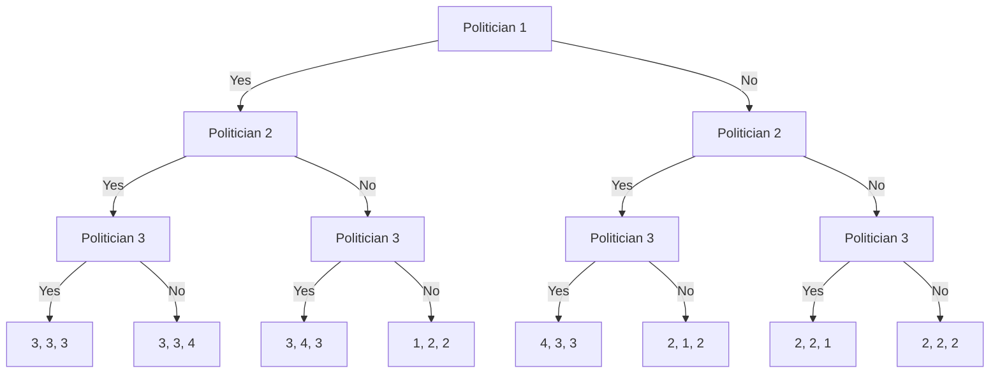
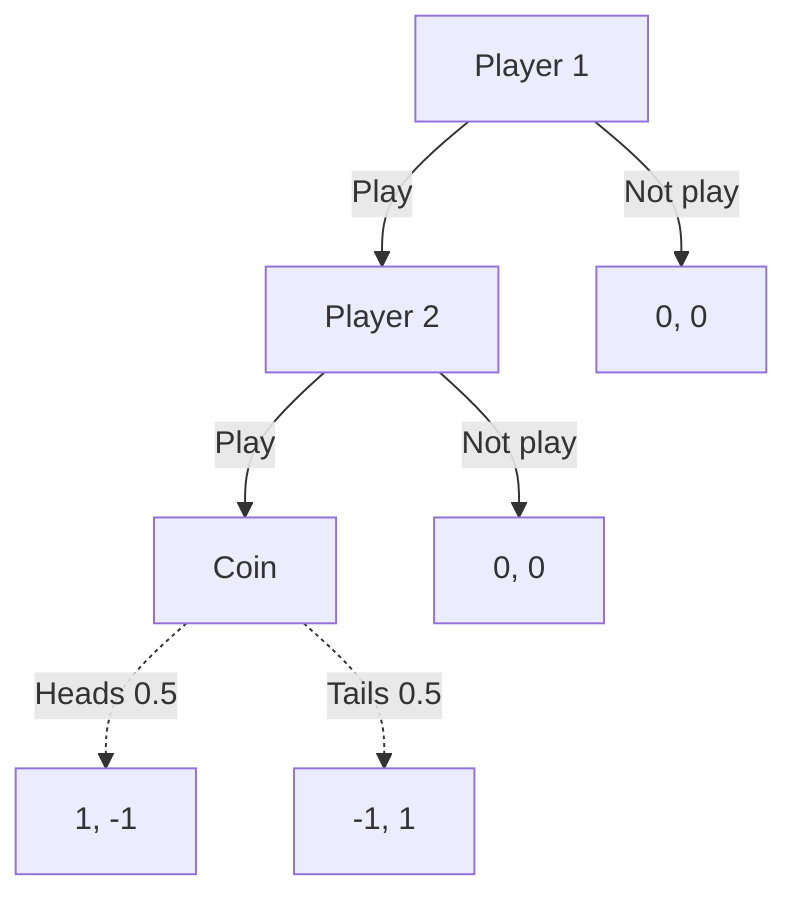
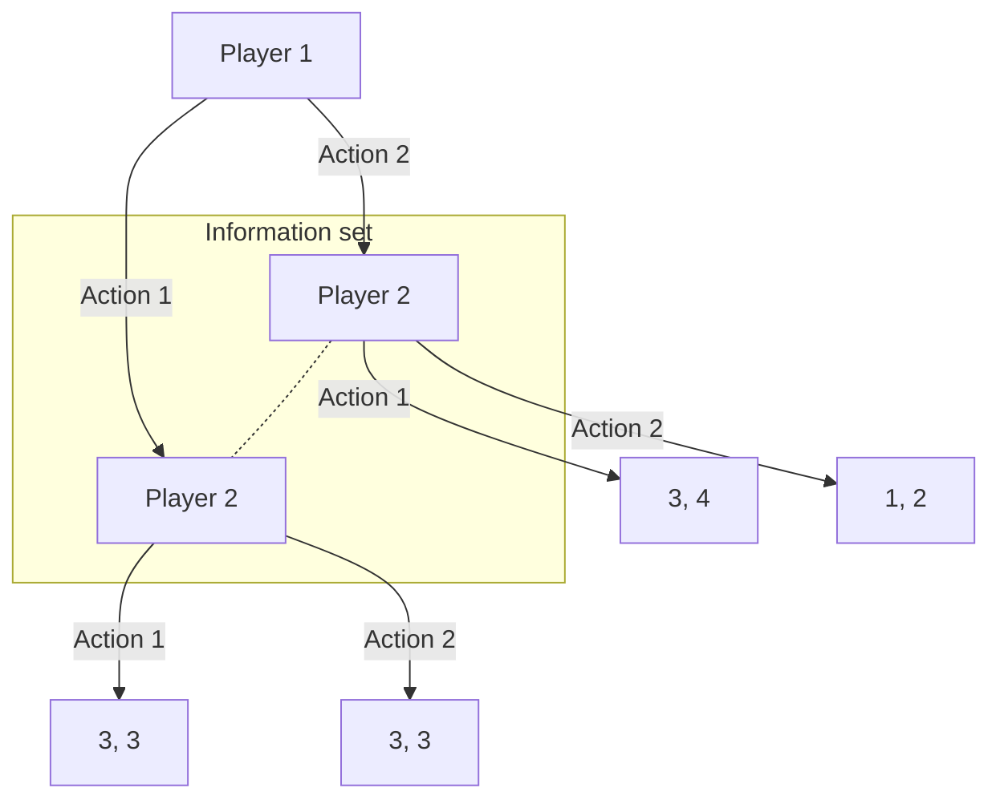

## Introduction to Games

Game theory studies situations where the outcome for one person depends not only on their own choices but on the choices of others.

A game is a process consisting of:

- a set of **players** (at least two)
- an **initial situation**
- **rules** the players must follow
- all possible **final situations** (outcomes)
- the **preferences** of all players over the final situations

### Players

**Players** are the agents that can make decisions in the game. They are assumed to be:

- **Selfish**: each player only cares about their own preferences over the outcomes.
- **Rational**: never takes action $a$ if another action $b$ is at least as good in every situation and strictly better in some.

The rationality is based on 5 assumptions:

1. Players can rank the outcomes of the game.
2. Players can provide a utility function for their ranking.
3. Players use the laws of probability consistently.
4. Players understand the consequences of their and others' actions, and the consequences of that information for every other player.
5. Players use decision theory whenever possible

#### Preference

A **preference relation** $\succeq$ ("is at least as good as") on a set $X$ is a binary relation such that for all $x, y, z \in X$:

- **Reflexive**: $x \succeq x$
- **Complete**: $x \succeq y$ or $y \succeq x$ (or both)
- **Transitive**: if $x \succeq y$ and $y \succeq z$, then $x \succeq z$

#### Utility functions

A **utility function** representing $\succeq$ is a function $u : X \to \mathbb{R}$ such that

$$u(x) \geq u(y) \iff x \succeq y$$

## Extensive Form Representation

### Perfect information

An **extensive form with perfect information** is a game represented as a **decision tree** where each player takes decisions in sequence and knows all the events that previously occurred.

The structure of an extensive form game with perfect information is:

1. a finite set of players $N = \{1, \dots, n\}$
2. a game tree $(V, E, x_0)$
3. a partition $\{P_1, \dots, P_n, P_{n+1}\}$ of the non-leaf vertices (decision nodes) into $n + 1$ sets
   - $P_i$, for $i \leq n$: nodes where player $i$ chooses a child (a move).
   - $P_{n+1}$: nodes with a **chance move** (it can be empty).
4. a probability distribution, for each vertex in $P_{n+1}$
5. an $n$-dimensional vector attached to each leaf (the list of outcomes)

> e.g. Three politicians vote **sequentially and publicly** on a salary raise. They would like the raise, but also want to vote against it to not lose public support. Optimal for each: _get the raise while voting against it_.
>
> Utilities depend on the individual vote and the final outcome:
>
> | Value | Meaning          |
> | ----- | ---------------- |
> | 1     | YES and no raise |
> | 2     | NO and no raise  |
> | 3     | YES and raise    |
> | 4     | NO and raise     |

#### Extensive form with chance

In case of chance nodes the $P_{n+1}$ partition is non-empty.

> Two players decide in sequence whether to play. If both play, a coin is tossed (random component R): heads, player 1 wins; tails, player 2 wins.

### Backward induction

The **backward induction** method allows to find the rational outcome of a perfect-information game using a dynamic programming approach.
Starting from the leaves, at each decision node, the player there picks the action that maximizes their own payoff, and that choice is treated as the resolved outcome for that node. This process continues up the tree until reaching the root.

> Applying backward induction to the voting game:
>
> | Node | Player | Choice | Resolves to |
> | ------------ | ------ | ------------------------------ | ------------- |
> | after (Y, Y) | 3 | No: (3,3,**4**) > (3,3,**3**) | (3, 3, 4) |
>| after (Y, N) | 3 | Yes: (3,4,**3**) > (1,2,**2**) | (3, 4, 3) |
>| after (N, Y) | 3 | Yes: (4,3,**3**) > (2,1,**2**) | (4, 3, 3) |
>| after (N, N) | 3 | No: (2,2,**2**) > (2,2,**1**) | (2, 2, 2) |
>| after Y | 2 | No: (3,**4**,3) > (3,**3**,4) | (3, 4, 3) |
>| after N | 2 | Yes: (4,**3**,3) > (2,**2**,2) | (4, 3, 3) |
>| root | 1 | No: (**4**,3,3) > (**3**,4,3) | **(4, 3, 3)** |
>
>Leading to the rational outcome of the game: politician 1 votes _No_, politician 2 votes _Yes_, and politician 3 votes _Yes_. The raise happens, and only politician 1 gets to dodge the blame while getting the ideal payoff.

### Perfect Information Theorems (Von Neumann theorem)

For any finite two-player game of perfect information with no chance moves (chess is the classic example), exactly one of the following holds:

1. Player 1 has a **winning strategy**, regardless of what player 2 does.
2. Player 2 has a **winning strategy**, regardless of what player 1 does.
3. Both players have a strategy that **guarantees at least a draw**, regardless of what the other does.

A winning strategy for player 1 means:

$$\exists a_1 \in A_1 : \forall b_1 \in B_1 : \exists a_2 \in A_2 : \forall b_2 \in B_2 : \cdots : \exists a_n \in A_n : \forall b_n \in B_n : \text{P1 wins}$$

This notation means that there exists a sequence of moves for player 1 such that, no matter what moves player 2 makes, player 1 can always respond in a way that leads to a win.

If this is not true, then player 2 can guarantee at least a draw.

The same holds for the other player.

### Solution concepts

The rational outcome of a game is called a **solution** and can be classified as follows:

- **Very weak solution**: A rational outcome exists, but it is not practically reachable/computable
- **Weak solution**: The outcome is known, but not _how_ to reach it
- **Solution**: The outcome is known and a way to reach it is known

## Impartial Combinatorial Games

An **impartial combinatorial game** is a game with the following properties:

- two players move in alternate order
- a finite number of positions
- the players follow the same rules
- no chance

In these games all the positions can be classified as:

- **P-position**: losing position for the player to move, each move goes to an N-position.
- **N-position**: winning position for the player to move, there is at least one move to a P-position.

### Nim

**Nim** is an impartial combinatorial game with $k$ piles $(n_1, \dots, n_k)$, on each turn a player removes any positive number of objects from a single pile, and the player who takes the last object wins.

Nim is solved with the **nim-sum**, $\oplus$: binary addition without carrying (equivalently, bitwise XOR). The natural numbers under $\oplus$ form an abelian group with identity $0$.

> Example: $1 \oplus 2 \oplus 4 \oplus 1 \to 001 \oplus 010 \oplus 100 \oplus 001 = 110 = 6$.

According to the **Bouton theorem**, a position $(n_1, \dots, n_k)$ is a P-position if and only if the nim-sum of the pile sizes is zero:

$$n_1 \oplus n_2 \oplus \cdots \oplus n_k = 0$$

## Imperfect Information

Games with **imperfect information** are those where players do not have complete knowledge of the game state when making decisions. This can occur due to simultaneous moves, hidden information, or uncertainty about the actions of other players.

Player $i$ knows they are in the **information set** $U_i$ but not in which vertex. Each element of the partition is an available move.

An **information set** for player $i$ is a pair $(U_i, A(U_i))$ with:

- $U_i \subseteq P_i$ a nonempty set of vertices $v_1, \dots, v_k$;
- every vertex $v_j \in U_i$ has the same number of children (same available moves);
- $A(U_i)$ is a partition of the children of $v_1 \cup \dots \cup v_k$ such that each element of the partition contains exactly one child of each $v_j$.

The formal definition is:

1. a finite set of players $N = \{1, \dots, n\}$
2. a game tree $(V, E, x_0)$
3. a partition $\{P_1, \dots, P_n, P_{n+1}\}$ of the non-leaf vertices
4. for each player $i$, a partition the decisions nodes $P_i$ into $k_i$ information sets $(U_i^j, A(U_i^j)), j = 1, \dots, k_i$
5. a probability distribution, for each vertex in $P_{n+1}$
6. an $n$-dimensional vector attached to each leaf (the list of outcomes)

A game with perfect information can be represented as a game with imperfect information where each information set contains is a singleton.

## Strategies

A **Strategy** is a complete plan of action for a player, specifying what they will do at every information set they might encounter.

There are two types of strategies:

- **Pure strategy**: at each information set, the player chooses a specific action deterministically.
- **Mixed strategy**: at each information set, the player chooses an action according to a probability distribution over the available actions.

### Strategic Form Representation

The **strategic form** representation of a game lists all possible combinations of strategies for each player, along with the resulting payoffs using a **payoff matrix**.

For two players, the payoff matrix is a bimatrix where each cell contains a pair of payoffs corresponding to the strategies chosen by the players.

$$\begin{pmatrix} (8,8) & (2,7) \\ (7,2) & (0,0) \end{pmatrix} \qquad \text{Utilities of Player 1: } \begin{pmatrix} 8 & 2 \\ 7 & 0 \end{pmatrix}$$

### Dominant Strategy

A strategy **dominates** another if it gives a better outcome regardless of what the other player does, based on the rationality assumption.

In the bimatrix above, the second row is strictly dominated by the first, so Player 1 plays row 1; likewise the first column strictly dominates the second for Player 2. Outcome: $(8,8)$.

## Zero-Sum Games

In a **zero-sum game** whatever one player gains, the other loses and it's represented by a triplet $(X, Y, f : X \times Y \to \mathbb{R})$:

- $X$ is the strategy space of Player 1 (Pl1). In the finite case $X = \{1, \dots, n\}$
- $Y$ is the strategy space of Player 2 (Pl2). In the finite case $Y = \{1, \dots, m\}$
- $f(x, y)$ is what Pl1 gets from Pl2 when they play $x, y$. The utility of Pl2 is $g(y, x) = -f(x, y)$.

The game is represented by the  **payoff matrix** $P$ that being the utilities opposite, is enough to describe the game without the bi-matrix:

$$P = \begin{pmatrix} p_{11} & \cdots & p_{1m} \\ \vdots & \ddots & \vdots \\ p_{n1} & \cdots & p_{nm} \end{pmatrix}$$

### Conservative values

The **conservative value** of a player is the best guaranteed outcome they can secure, assuming the opponent plays optimally against them.

- Pl1 looks at each row, assumes Pl2 will choose the column that minimizes its lost, and keeps the row that gives the best outcome in the worst-case scenario.
  - Finite case: $v_1 = \max_i \min_j p_{ij}$ given by playing row $\bar{i}$ ($p_{\bar{i} j} \geq v_1 \forall j$)
  - General case: $v_1 = \sup_x \inf_y f(x, y)$ given by playing $x = \bar{x}$
- Pl2 looks at each column, assumes Pl1 will choose the row that maximizes its gain, and keeps the column that gives the best outcome in the worst-case scenario.
  - Finite case: $v_2 = \min_j \max_i p_{ij}$ given by playing column $\bar{j}$ ($p_{i \bar{j}} \geq v_2 \forall i$)
  - General case: $v_2 = \inf_y \sup_x f(x, y)$ given by playing $y = \bar{y}$

For any nonempty $X, Y$ and any $f : X \times Y \to \mathbb{R}$:

$$v_1 = \sup_x \inf_y f(x, y) \leq \inf_y \sup_x f(x, y) = v_2$$

> Proof: For all $x, y$:
>
> $$\alpha(x) = \inf_{y'} f(x, y') \leq f(x, y) \leq \sup_{x'} f(x', y) = \beta(y)$$
>
> Since $\alpha(x) \leq \beta(y) \forall x \in X, y \in Y$, $\sup_x \alpha(x) \leq \inf_y \beta(y)$.

#### Pure optimal strategies

If $v_1 = v_2 = v$, the game has value $v$ and can be solved in pure strategies by:

- Pl1: play row $\bar{i}$ with $p_{\bar{i} j} \geq v \forall j$
- Pl2: play column $\bar{j}$ with $p_{i \bar{j}} \leq v \forall i$

#### Mixed Strategy

If $v_1 < v_2$, the game has no solution in pure strategies, but it can be solved in **mixed strategies**, represented by $(\Sigma_n, \Sigma_m, f(x, y) = (x, Py))$.

$\Sigma_k$ is the probability distribution ($k = n$ for Pl1, $k = m$ for Pl2) over the pure strategies:

$$\Sigma_k = \{ x = (x_1, \dots, x_k) : x_i \geq 0, \ \sum_{i=1}^k x_i = 1 \}$$

Expected utility is the weighted sum of the payoffs with the product probabilities:

$$f(x, y) = \sum_{i=1}^n \sum_{j=1}^m x_i y_j  p_{ij} = (x, Py)$$

### Convexity

A set $C \subseteq \mathbb{R}^n$ is **convex** if the segment joining any two points of $C$ stays in $C$:

$$\lambda x + (1 - \lambda) y \in C \quad \forall x, y \in C, \forall \lambda \in [0, 1]$$

A **convex combination** of $x_1, \dots, x_n$ is a vector $x = \lambda_1 x_1 + \cdots + \lambda_n x_n$ with $\lambda_i \geq 0$ and $\sum_i \lambda_i = 1$

The **convex hull** of $C$ is the smallest convex set containing $C$:

$$\mathrm{co} C = \bigcap_{A \in \mathcal{C}} A, \quad \mathcal{C} = \{ A : C \subseteq A, A \text{ convex} \}$$

Equivalently, it is the set of all convex combinations of points of $C$:

$$\mathrm{co} C = \{ \sum_{i=1}^n \lambda_i c_i : \lambda_i \geq 0, \ \sum_{i=1}^n \lambda_i = 1, \ c_i \in C, \ n \in \mathbb{N} \}$$

If $C$ is a finite set of points, $\mathrm{co} C$ is a **polytope**.

The **complement** of $C$ is the set of all points in $\mathbb{R}^n$ that are not in $C$: $C^c = \mathbb{R}^n \setminus C$.

The **interior** of $C$ is the set of points that have a neighborhood entirely contained in $C$: $\mathrm{int} C = \{ x \in C : \exists r > 0, B_r(x) \subseteq C \}$.

The **closure** of $C$ is the union of $C$ and its boundary: $\mathrm{cl} C = C \cup \partial C$. It is the set of limits of sequences of points of $C$.

#### Projection

Given a closed convex set $C$ and a point $x \notin C$, the **projection** $p$ of $x$ onto $C$ is the closest point of $C$ to $x$ ($|p - x| \leq |c - x| \forall c \in C$).

$$(x - p, c - p) \leq 0 \quad \forall c \in C$$

- As $C$ is convex, the projection $p$ is unique.
- The angle at $p$ between $x$ and any $c \in C$ is obtuse.

#### Separation

Given a closed convex set $C$ and a point $\bar{x} \notin C$, it's possible to find a hyperplane characterized by a normal vector $x^* \neq 0$ that separates $\bar{x}$ from $C$.

$$(x^*, c) \geq (x^*, \bar{x}) \quad \forall c \in C$$

> Taking the closest point $p$ ($(\bar{x} - p, c - p) \leq 0$) of $C$ to $\bar{x}$, the hyperplane is given by the normal vector $x^* = p - \bar{x}$ that is orthogonal to the segment joining $\bar{x}$ and $p$.
>
> By substitution: $(\bar{x} - p, c - p) = (-x^*, c - \bar{x} - x^*) = -(x^*, c - \bar{x}) + \|x^*\|^2 \leq 0$, so $(x^*, c - \bar{x}) \geq \|x^*\|^2 > 0$ that by linearity:
>
> $$(x^*, c) \geq (x^*, \bar{x}) \quad \forall c \in C$$
>
> meaning that all the point of $C$ are on one side of the hyperplane with normal vector $x^*$.

For a closed convex $C$ and a point $x$ on its boundary there is a **supporting hyperplane** at $x$.

Given two closed convex sets $A, C$ with $\mathrm{int} A \cap C = \emptyset$, there is a **separating hyperplane** $H = \{ x : (x^*, x) = b \}$ that separates $A$ and $C$ into the two different half-spaces it generates.

$$(x^*, a) \geq b \geq (x^*, c) \quad \forall a \in A, \forall c \in C$$

> Taking the set $\mathrm{int} A - C = \{ x = a - c : a \in \mathrm{int} A, c \in C \}$, as they are disjoint the point $0$ is not in it, and it is convex as the difference of two convex sets.
>
> By the separation theorem there is a hyperplane with normal vector $x^* \neq 0$ that separates it from $0$:
>
> $$(x^*, a - c) \geq 0 \quad \forall a \in \mathrm{int} A, c \in C$$
>
> by linearity $(x^*, a) - (x^*, c) \geq 0$, so $(x^*, a) \geq (x^*, c)$.

### Von Neumann theorem

A **two-player zero-sum game** has always a **rational outcome** in mixed strategies, meaning that there are $\bar{x} \in \Sigma_n$, $\bar{y} \in \Sigma_m$ and a value $v$ such that $v_1 = v_2 = v$.

If a player knows the (mixed) strategy of the other, it can always answer with a pure strategy.

Once Pl1 knows the strategy $\bar{y}$ of Pl2, it need to maximize the utility function $f(x, \bar{y}) = (x, P \bar{y})$ over $x \in \Sigma_n$. The maximum is attained at a vertex of $\Sigma_n$, that is a pure strategy.

There is a distribution $\bar{x}$ over rows such that against every column Pl1 gets at least $v$, and a distribution $\bar{y}$ over columns such that against every row Pl2 pays at most $v$.

> The columns of $P$ are points of $\mathbb{R}^n$ and a mixed strategy of Pl2 is a convex combination of those points $C = \mathrm{co}\{p_{\cdot 1}, \dots, p_{\cdot m}\}$.
>
> Taking the set $Q_t = {x \in \mathbb{R}^n : x_i \leq t, \forall i}$ where $t$ is the value of the game.
>
> The value $v$ is the highest $t$ for which $Q_t$ and $C$ do not meet ($v = \sup \{ t \geq 0 : Q_t \cap C = \emptyset \}$). meaning $v$ is the lowest ceiling Pl2 can enforce on all rows.
>
> For the separation theorem, there is a hyperplane with normal vector $\bar{x}$ that separates $Q_v$ and $C$ such that:
>
> $$(\bar{x}, u) \leq b \leq (\bar{x}, w) \quad \forall u \in Q_v, \forall w \in C$$
>
> - $\bar{x}$ is a probability distribution (all $\bar{x}_i \geq 0$ and $\sum_i \bar{x}_i = 1$)
> - $b = v$ (the hyperplane is tangent to $Q_v$)

### Optimal strategies by Linear Programming

The optimal strategy of a game can be found by solving a linear programming problem.

Pl1 chooses $x \in \Sigma_n$ to **maximize** $v$ subject to $(x, p_{\cdot j}) \geq v$ for every column $j$:

$$\begin{aligned} \max_{x, v} \quad & v \\ \text{s.t.} \quad & \sum_{i=1}^n x_i p_{ij} \geq v, \quad j = 1, \dots, m \qquad (P^T x \geq v 1_m) \\ & \sum_{i=1}^n x_i = 1, \quad x_i \geq 0 \end{aligned} \qquad \begin{cases} \max_{x, v} v \\ P^T x \geq v 1_m \\ x \geq 0 \\ (1, x) = 1 \end{cases}$$

Pl2 chooses $y \in \Sigma_m$ to **minimize** $w$ subject to $(p_{i \cdot}, y) \leq w$ for every row $i$:

$$\begin{aligned} \min_{y, w} \quad & w \\ \text{s.t.} \quad & \sum_{j=1}^m y_j p_{ij} \leq w, \quad i = 1, \dots, n \qquad (Py \leq w 1_n) \\ & \sum_{j=1}^m y_j = 1, \ \ y_j \geq 0 \end{aligned} \qquad \begin{cases} \max_{y, w} w \\ Py \leq w 1_n \\ y \geq 0 \\ (1, y) = 1 \end{cases}$$

The two problems are dual to each other.

For the weak duality, let $v, w$ be the optimal values of the primal and dual problems. Then $v \leq w$.

For the strong duality, if the primal and dual are both feasible, then $v = w$.

For the complementary condition, let $\bar{x}, \bar{y}$ be primal and dual feasible. They are simultaneously optimal iff:

$$\begin{cases} \forall i: \ \bar{x}_i > 0 \Rightarrow \sum_{k=1}^m p_{ik} \bar{y}_k = v \\ \forall j: \ \bar{y}_j > 0 \Rightarrow \sum_{k=1}^n p_{kj} \bar{x}_k = v \end{cases}$$

#### Indifference principle

The indifference principle states that in a mixed strategy equilibrium, each player is indifferent among the pure strategies that are played by the other player.

### Fair games

A finite zero-sum game is **fair** if no player has an advantage over the other. In a fair game, the value is $0$, meaning that if both players play optimally, neither player can expect to gain or lose anything on average.

If the $P$ matrix is **antisymmetric** if $p_{ij} = -p_{ji} \forall i, j$ , it's possible to exchange the roles of the players ($P^T = -P$).

> Since $P^T = -P$,by playing the same strategy each player can get 0:
>
> $$(Px, x) = (x, P^T x) = -(x, Px) = -(Px, x) \Rightarrow f(x, x) = 0 \forall x$$
>
> - $v_1 \leq 0$;
> - $v_2 \geq 0$.
>
> For von Neumann $v_1 = v_2 = v = 0$, as 0 is the only common value.
>
> If $\bar{x}$ is optimal for Pl1, then $(\bar{x}, P y) \geq 0 \ \forall y$, which by antisymmetry is $(P \bar{x}, y) \leq 0 \ \forall y$.
