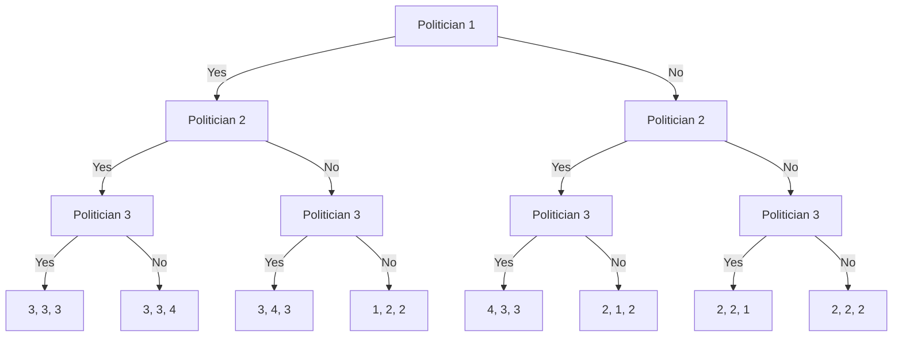
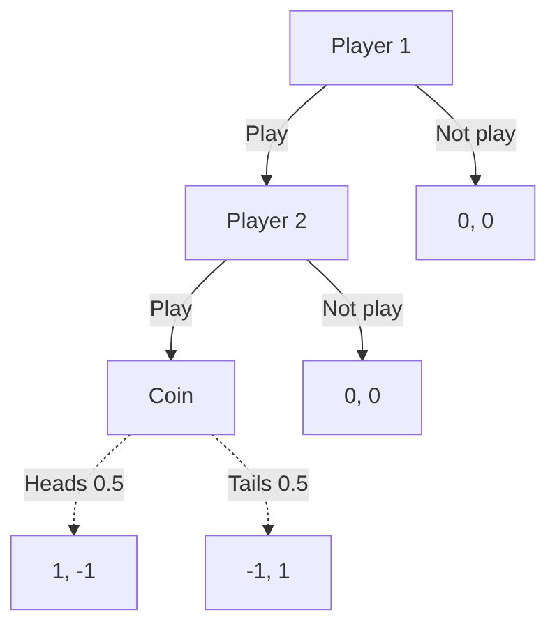
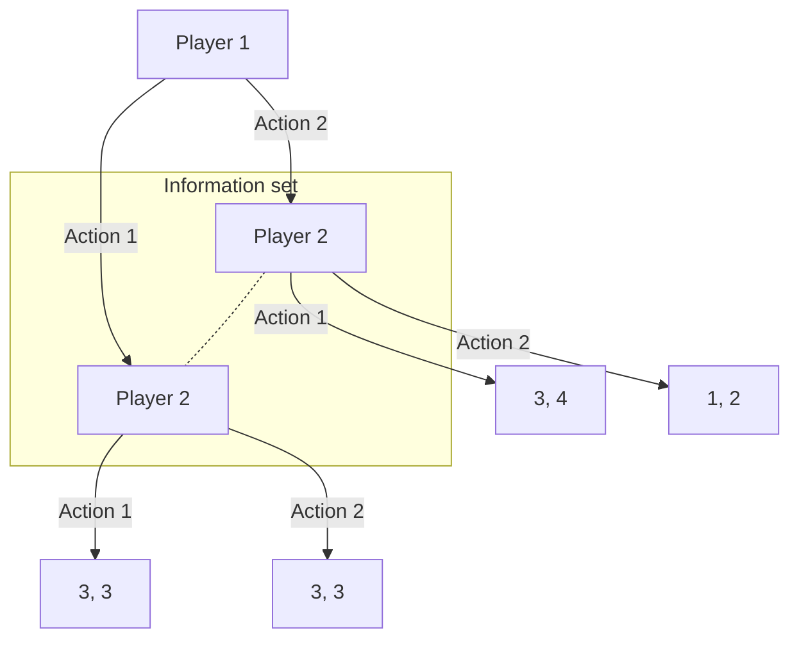

## Introduction to Games

Game theory studies situations where the outcome for one person depends not only on their own choices but on the choices of others.

A game is a process consisting of:

- a set of **players** (at least two)
- an **initial situation**
- **rules** the players must follow
- all possible **final situations** (outcomes)
- the **preferences** of all players over the final situations

### Players

**Players** are the agents that can make decisions in the game. They are assumed to be:

- **Selfish**: each player only cares about their own preferences over the outcomes.
- **Rational**: never takes action $a$ if another action $b$ is at least as good in every situation and strictly better in some.

The rationality is based on 5 assumptions:

1. Players can rank the outcomes of the game.
2. Players can provide a utility function for their ranking.
3. Players use the laws of probability consistently.
4. Players understand the consequences of their and others' actions, and the consequences of that information for every other player.
5. Players use decision theory whenever possible

#### Preference

A **preference relation** $\succeq$ ("is at least as good as") on a set $X$ is a binary relation such that for all $x, y, z \in X$:

- **Reflexive**: $x \succeq x$
- **Complete**: $x \succeq y$ or $y \succeq x$ (or both)
- **Transitive**: if $x \succeq y$ and $y \succeq z$, then $x \succeq z$

#### Utility functions

A **utility function** representing $\succeq$ is a function $u : X \to \mathbb{R}$ such that

$$u(x) \geq u(y) \iff x \succeq y$$

## Extensive Form Representation

### Perfect information

An **extensive form with perfect information** is a game represented as a **decision tree** where each player takes decisions in sequence and knows all the events that previously occurred.

The structure of an extensive form game with perfect information is:

1. a finite set of players $N = \{1, \dots, n\}$
2. a game tree $(V, E, x_0)$
3. a partition $\{P_1, \dots, P_n, P_{n+1}\}$ of the non-leaf vertices (decision nodes) into $n + 1$ sets
   - $P_i$, for $i \leq n$: nodes where player $i$ chooses a child (a move).
   - $P_{n+1}$: nodes with a **chance move** (it can be empty).
4. a probability distribution, for each vertex in $P_{n+1}$
5. an $n$-dimensional vector attached to each leaf (the list of outcomes)

> e.g. Three politicians vote **sequentially and publicly** on a salary raise. They would like the raise, but also want to vote against it to not lose public support. Optimal for each: _get the raise while voting against it_.
>
> Utilities depend on the individual vote and the final outcome:
>
> | Value | Meaning          |
> | ----- | ---------------- |
> | 1     | YES and no raise |
> | 2     | NO and no raise  |
> | 3     | YES and raise    |
> | 4     | NO and raise     |

#### Extensive form with chance

In case of chance nodes the $P_{n+1}$ partition is non-empty.

> Two players decide in sequence whether to play. If both play, a coin is tossed (random component R): heads, player 1 wins; tails, player 2 wins.

### Backward induction

The **backward induction** method allows to find the rational outcome of a perfect-information game using a dynamic programming approach.
Starting from the leaves, at each decision node, the player there picks the action that maximizes their own payoff, and that choice is treated as the resolved outcome for that node. This process continues up the tree until reaching the root.

> Applying backward induction to the voting game:
>
> | Node | Player | Choice | Resolves to |
> | ------------ | ------ | ------------------------------ | ------------- |
> | after (Y, Y) | 3 | No: (3,3,**4**) > (3,3,**3**) | (3, 3, 4) |
>| after (Y, N) | 3 | Yes: (3,4,**3**) > (1,2,**2**) | (3, 4, 3) |
>| after (N, Y) | 3 | Yes: (4,3,**3**) > (2,1,**2**) | (4, 3, 3) |
>| after (N, N) | 3 | No: (2,2,**2**) > (2,2,**1**) | (2, 2, 2) |
>| after Y | 2 | No: (3,**4**,3) > (3,**3**,4) | (3, 4, 3) |
>| after N | 2 | Yes: (4,**3**,3) > (2,**2**,2) | (4, 3, 3) |
>| root | 1 | No: (**4**,3,3) > (**3**,4,3) | **(4, 3, 3)** |
>
>Leading to the rational outcome of the game: politician 1 votes _No_, politician 2 votes _Yes_, and politician 3 votes _Yes_. The raise happens, and only politician 1 gets to dodge the blame while getting the ideal payoff.

### Perfect Information Theorems (Von Neumann theorem)

For any finite two-player game of perfect information with no chance moves (chess is the classic example), exactly one of the following holds:

1. Player 1 has a **winning strategy**, regardless of what player 2 does.
2. Player 2 has a **winning strategy**, regardless of what player 1 does.
3. Both players have a strategy that **guarantees at least a draw**, regardless of what the other does.

A winning strategy for player 1 means:

$$\exists a_1 \in A_1 : \forall b_1 \in B_1 : \exists a_2 \in A_2 : \forall b_2 \in B_2 : \cdots : \exists a_n \in A_n : \forall b_n \in B_n : \text{P1 wins}$$

This notation means that there exists a sequence of moves for player 1 such that, no matter what moves player 2 makes, player 1 can always respond in a way that leads to a win.

If this is not true, then player 2 can guarantee at least a draw.

The same holds for the other player.

### Solution concepts

The rational outcome of a game is called a **solution** and can be classified as follows:

- **Very weak solution**: A rational outcome exists, but it is not practically reachable/computable
- **Weak solution**: The outcome is known, but not _how_ to reach it
- **Solution**: The outcome is known and a way to reach it is known

## Impartial Combinatorial Games

An **impartial combinatorial game** is a game with the following properties:

- two players move in alternate order
- a finite number of positions
- the players follow the same rules
- no chance

In these games all the positions can be classified as:

- **P-position**: losing position for the player to move, each move goes to an N-position.
- **N-position**: winning position for the player to move, there is at least one move to a P-position.

### Nim

**Nim** is an impartial combinatorial game with $k$ piles $(n_1, \dots, n_k)$, on each turn a player removes any positive number of objects from a single pile, and the player who takes the last object wins.

Nim is solved with the **nim-sum**, $\oplus$: binary addition without carrying (equivalently, bitwise XOR). The natural numbers under $\oplus$ form an abelian group with identity $0$.

> Example: $1 \oplus 2 \oplus 4 \oplus 1 \to 001 \oplus 010 \oplus 100 \oplus 001 = 110 = 6$.

According to the **Bouton theorem**, a position $(n_1, \dots, n_k)$ is a P-position if and only if the nim-sum of the pile sizes is zero:

$$n_1 \oplus n_2 \oplus \cdots \oplus n_k = 0$$

## Imperfect Information

Games with **imperfect information** are those where players do not have complete knowledge of the game state when making decisions. This can occur due to simultaneous moves, hidden information, or uncertainty about the actions of other players.

Player $i$ knows they are in the **information set** $U_i$ but not in which vertex. Each element of the partition is an available move.

An **information set** for player $i$ is a pair $(U_i, A(U_i))$ with:

- $U_i \subseteq P_i$ a nonempty set of vertices $v_1, \dots, v_k$;
- every vertex $v_j \in U_i$ has the same number of children (same available moves);
- $A(U_i)$ is a partition of the children of $v_1 \cup \dots \cup v_k$ such that each element of the partition contains exactly one child of each $v_j$.

The formal definition is:

1. a finite set of players $N = \{1, \dots, n\}$
2. a game tree $(V, E, x_0)$
3. a partition $\{P_1, \dots, P_n, P_{n+1}\}$ of the non-leaf vertices
4. for each player $i$, a partition the decisions nodes $P_i$ into $k_i$ information sets $(U_i^j, A(U_i^j)), j = 1, \dots, k_i$
5. a probability distribution, for each vertex in $P_{n+1}$
6. an $n$-dimensional vector attached to each leaf (the list of outcomes)

A game with perfect information can be represented as a game with imperfect information where each information set contains is a singleton.

## Strategies

A **Strategy** is a complete plan of action for a player, specifying what they will do at every information set they might encounter.

There are two types of strategies:

- **Pure strategy**: at each information set, the player chooses a specific action deterministically.
- **Mixed strategy**: at each information set, the player chooses an action according to a probability distribution over the available actions.

### Strategic Form Representation

The **strategic form** representation of a game lists all possible combinations of strategies for each player, along with the resulting payoffs using a **payoff matrix**.

For two players, the payoff matrix is a bimatrix where each cell contains a pair of payoffs corresponding to the strategies chosen by the players.

$$\begin{pmatrix} (8,8) & (2,7) \\ (7,2) & (0,0) \end{pmatrix} \qquad \text{Utilities of Player 1: } \begin{pmatrix} 8 & 2 \\ 7 & 0 \end{pmatrix}$$

### Dominant Strategy

A strategy **dominates** another if it gives a better outcome regardless of what the other player does, based on the rationality assumption.

In the bimatrix above, the second row is strictly dominated by the first, so Player 1 plays row 1; likewise the first column strictly dominates the second for Player 2. Outcome: $(8,8)$.
